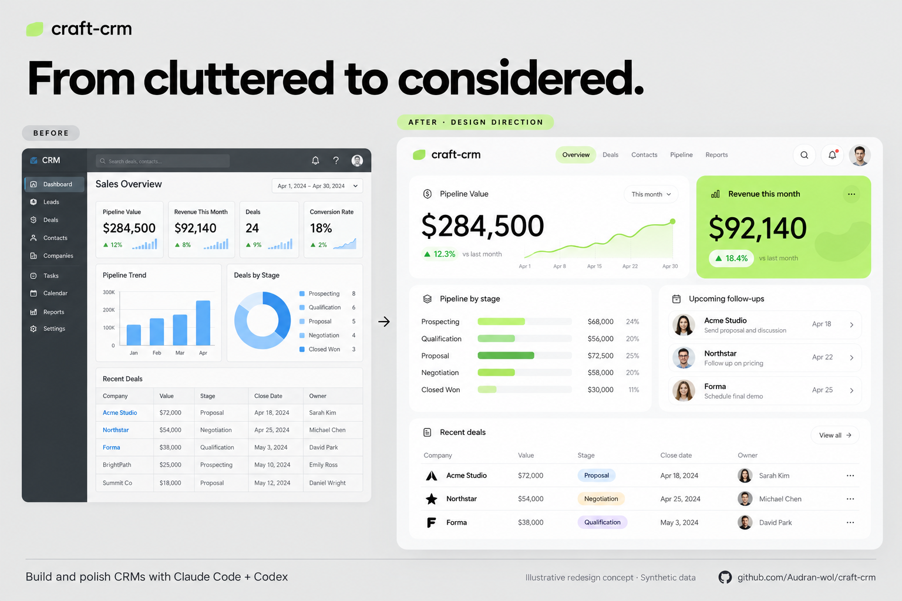

# craft-crm

Build, audit and polish CRM interfaces with concrete workflow contracts and evidence-based checks. **v0.1.0 · MIT**

Use it for new CRMs, dashboard polish, filter-heavy records/search pages and staged improvements to an existing app. It preserves the project's stack, routes and working behavior. It guides a coding agent; it does not install a CRM backend or certify the generated app.

## A visual direction to build toward



*AI-generated before-and-after design concept with synthetic data, not a measured result from running the skill. This illustrates a possible visual direction; reproduction of this design in a working app has not yet been validated.*

To explore the “after” direction, attach the image to your coding agent and ask:

```text
Use craft-crm to build a working sales CRM using the “after” panel as visual direction.
Use a light gray canvas, rounded white surfaces, a restrained lime accent,
generous spacing, strong metric typography and compact top navigation.
Include pipeline value, revenue over time, follow-ups and active deals.
Derive metrics and charts from coherent synthetic records. Connect the
summary to working filters, record details and editing. Adapt the layout
for mobile and verify keyboard interactions. Preserve the existing stack.
```

For an implemented example and its verification limits, see the
[sales prototype](examples/sales/index.html) and [evaluation record](evaluations/RESULTS.md).

## Install

Run from the project where you want the skill. Choose your agent:

**Claude Code**

```sh
npx skills add Audran-wol/craft-crm --skill craft-crm -a claude-code
```

**Codex**

```sh
npx skills add Audran-wol/craft-crm --skill craft-crm -a codex
```

Start a **new agent session** after installation so it discovers the skill. In Claude Code invoke `/craft-crm`; in Codex invoke `$craft-crm`. Add `-g` for a user-wide installation or `--copy` for independent files instead of links. The Skills CLI currently requires Node.js 22.20 or newer; Python 3.9+ is only needed for the bundled review tools. See the [Skills CLI installation reference](https://github.com/vercel-labs/skills/blob/main/docs/commands.md).

For a local ZIP, extract the `craft-crm` folder and substitute its absolute path for `Audran-wol/craft-crm` in the same command. Keep the complete skill folder together. The repository, release archive root and `name:` entry all use `craft-crm`.

## Try it

Claude Code:

```text
/craft-crm Audit this dashboard. Rank findings by priority, separate observed issues from unverified risks, and give acceptance checks. Report only; do not change source.
```

Codex:

```text
Use $craft-crm to polish this existing CRM's records page. Preserve its stack,
routes, data contracts and business logic. Improve the query bar, custom
pop-outs, rows and responsive layout. Implement focused changes and verify
filters, record navigation and editing. Show what changed and what remains unverified.
```

For a new app:

```text
Use craft-crm to build a recruiting CRM with candidates, roles, applications
and interviews. Use the existing stack and synthetic data. Start with
application review; choose the best visual direction and build.
```

Use `/craft-crm` or `$craft-crm` as appropriate to the agent. See [TESTING.md](TESTING.md) for an existing-project trial prompt and feedback checklist.

## What is included

- Records, tables, typed filters, saved views, details, forms, activities and optional pipelines.
- Four task-led layout directions and starting models for 12 CRM contexts.
- Custom-dropdown and pop-out contracts: open-state styling, sibling ownership, Escape, focus, placement and modal layering.
- Guidance for jobs/lead search-results pages, staged revamps, data boundaries and adverse states.
- Light/dark CSS tokens, original SVG studies, build/audit templates and 52 annotated historical research resources.
- Local validators, a reviewer-evidence scorer, regression tests and a synthetic [sales prototype](examples/sales/index.html).

The audit workflow identifies priorities and verifiable acceptance checks; it does not silently turn an audit-only request into implementation. Optional modules are selected from the actual task.

## Review tools

From this repository root:

```sh
python3 skills/craft-crm/scripts/validate_bundle.py
python3 -B -m unittest discover -s tests -v
```

Fill a copy of `skills/craft-crm/assets/audit-template.json`, then score it:

```sh
python3 skills/craft-crm/scripts/score_audit.py completed-audit.json --format text
```

`NOT READY` is a successfully processed review with findings or unverified checks. Exit **0** = ready within the submitted scope; **1** = not ready; **2** = invalid input. JSON remains the default for automation; its first field is `status`. The 85/100 threshold is a review heuristic, not a rating of the skill. The scorer never inspects a UI or certifies accessibility.

## Evidence and maintenance

The skill was exercised on a synthetic build, a recruiting plan and a report-only audit, followed by scoped repairs. A maintainer-provided existing-project report informed the search-results/pop-out improvements. See [evaluation evidence and limits](evaluations/RESULTS.md); no private application screenshots or transcript are included.

[RELEASE.md](RELEASE.md) explains reproduction and packaging. Linked resources keep their own terms; the historical source catalog is not a guarantee of current library APIs or independently verified accessibility. Retest actual implementations.

Licensed under [MIT](LICENSE). Contributions should include a concrete use case, preserved behavior and evidence for the change.
